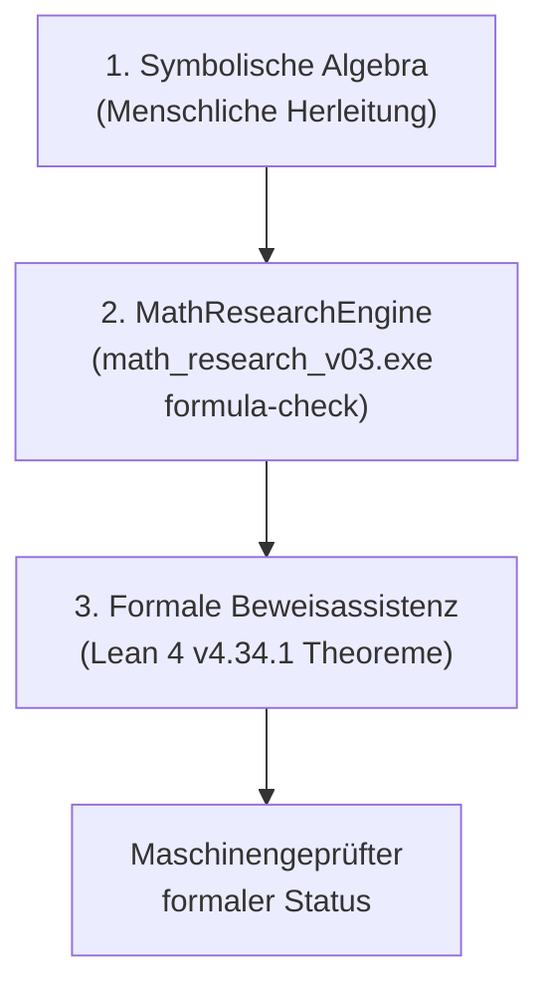

# Zusammenfassung

Subquantum Graphity (SubQG) untersucht, ob sich Raumzeit, interne Uhren, Trägheit und Gravitationswechselwirkungen aus einem substratfreien Quantennetzwerk herleiten lassen, dessen fundamentale Zustände vor-geometrisch durch Phasenbeziehungen beschrieben werden. Der vorliegende Forschungsstand **FPV11 (Version 3.0)** erweitert das bisherige Fundament um eine additive, ausschließlich SubQG-interne Universumsentwicklung sowie deren numerische und formale Prüfung:

1. **Das SubQG Apfel-Experiment (Objektgravitation & Äquivalenzprinzip):** Aus der geschlossenen variationellen Kantenmetrik-Gleichung $(\mu \mathbb{I} + \kappa \mathcal{L}_{\mathrm{edge}})x_e = -\beta w_e \rho_e$ und der unitären Soliton-Wellenpaketdynamik wird hergeleitet, warum derselbe Mechanismus sowohl die massenproportionale Haltekraft (das Gewicht $F_{\mathrm{Halten}} \propto m_{\mathrm{inert}}$) als auch den universellen, massenunabhängigen freien Fall ($\ddot{X}_{\mathrm{frei}} \approx g_{\mathrm{eff}}$) konkreter, ausgedehnter Resonanzobjekte erzeugt – ohne jedes Hardcoding von $F = mg$. Über eine experimentelle Massenspanne von $9{,}00\times$ stimmen Fallbeschleunigungen auf $\eta_{\max} = 0{,}0255\,\%$ überein; die lineare Gewichtsregression erreicht $R^2 = 0{,}999994$. Alle 10 Pflichtkontrollen (C1–C10) sind bestanden.
2. **Das SubQG-Vakuum und der Asteroidenflug:** Es wird analytisch und numerisch bewiesen, dass der interplanetare Raum im SubQG kein leeres „Nichts“ ist, sondern ein aktives, kondensiertes Quantennetzwerk mit Phasenüberlappung $w_e \approx 1$. Für Geschwindigkeiten unterhalb der emergenten Grenzgeschwindigkeit $c = 2 J_0 L_0$ verhält sich dieses Vakuum verlustfrei und suprafluid (Reibungswiderstand $F_{\mathrm{drag}} = 0$). Ein frei fliegender Asteroid gleitet geradlinig mit $v = \mathrm{const.}$, während bei der Annäherung an einen Himmelskörper eine rein refraktive Geodätenkrümmung durch Kantenverkürzung $L_e = L_0 e^{x_e} < L_0$ eintritt.
3. **Orthogonale überlappende Multiversen am selben Ort:** Auf einem gemeinsamen Knotenensemble $\mathcal{V}$ wird gezeigt, dass zwei vollständige 3D-Universen am exakt selben Ort zur selben Zeit existieren können, ohne sich gravitativ oder elektromagnetisch zu beeinflussen, sofern ihre Kantennetzwerke über orthogonale Phasenräume $\langle A | B \rangle = 0$ entkoppelt sind ($E_A \cap E_B = \emptyset$).
4. **Emergente Universumsentwicklung ohne importierte Astrophysik:** `SubQGUniverseEvolution` startet mit einem relationalen Ereignis ohne räumliche Kante und aktualisiert Knoten, Kanten, Simplexe und interne Zeit ausschließlich über die vorhandene SubQG-Phasendynamik und Energie–Metrik-Rückkopplung. Ein kanonischer Lauf erreicht 2.000 Epochen beziehungsweise zwei Milliarden explizit kalibrierte Anzeigejahre. Er archiviert auch Strukturen, die zunächst unbekannt bleiben. Stern-, Planeten-, Nebel-, Galaxie- und Supernovabezeichnungen sind nachträgliche Signaturhypothesen und keine vorprogrammierten Körperklassen.
5. **Erweiterte Formelanalyse & formale Lean-4-Verifikation:** Die Lean-Suite umfasst nun drei Dateien mit **75 kernelgeprüften Theoremen**: 34 Sätze zum SubQG-Kern, 23 Formeltheoreme einschließlich aller 20 nummerierten Formeln und 18 Sätze zur Universumsentwicklung. Der gemeinsame Lauf mit **Lean 4.34.1** endet mit Exitcode 0, ohne Warnungen, Fehler oder Beweisabkürzungen wie `sorry`, `admit` oder `sorryAx`.
6. **Software, Tests & interaktiver Webviewer:** Die Gesamttestsuite umfasst **364 von 364 bestandene JavaScript-Tests**. Zusätzlich bestehen alle 8 internen Langzeitgates des Zwei-Milliarden-Jahre-Laufs. Der `SubQG Universe Explorer` berechnet Live-Snapshots der unveränderten Engine in einem separaten Worker und ermöglicht freien Flug, Zeitnavigation, Zielanflug und die Untersuchung unbekannter Strukturen in einer ausdrücklich nichtphysikalischen visuellen 3D-Einbettung. Seine filmische Morphologie wird deterministisch aus Energie, Kohärenz, Kontraktion, Fluss, Persistenz und den konkurrierenden SubQG-Signaturhypothesen erzeugt; unbekannte Strukturen werden erst nach Erfüllung der mathematischen Auflösungsschwellen als Galaxien-, Nebel-, Kern- oder Orbitalkandidat bezeichnet. Aufgelöste Galaxienkomplexe erscheinen als abgegrenzte Scheiben mit datenabhängiger Armzahl, während Stern- und Orbitalkandidaten als erkennbare Körper statt bloßer Leuchtpunkte dargestellt werden.

**Schlüsselwörter:** SubQG; Genesis; emergente Raumzeit; Universumsentwicklung; unbekannte Strukturen; relationale Zeit; Äquivalenzprinzip; Kantenmetrik; MOND-Crossover; orthogonale Multiversen; Lean 4; formale Verifikation.

---

# 1. Forschungsziel und erweiterte Aussageebenen

Die zentrale Fragestellung lautet: **Wie erzeugen gemeinsame mikroskopische Phasenregeln ein emergentes Raumzeit-Kontinuum, darin persistente und möglicherweise völlig neue Strukturen sowie die konkrete Dynamik makroskopischer Objekte; wie verhalten sich mehrere solche Raumzeiten zueinander, und welche Teile dieser Entwicklung lassen sich maschinell formal verifizieren?**

Zur wissenschaftlichen Exaktheit werden sechs Ebenen strikt getrennt:

| Ebene | Bedeutung im FPV11-Whitepaper |
|---|---|
| **Modellpostulat** | Phasenüberlappungsregel $w_e$, Kantenwirkungsfunktional $S_{\mathrm{edge}}[x]$, Hamilton-Operator $\mathcal{H}_{\mathrm{total}}[x, \Psi]$, solitäre Selbstbindung $g_{\mathrm{nl}}$. |
| **Analytische Folgerung** | Ausdrückliche mathematische Konsequenzen (z. B. Ehrenfest-Theorem auf dem Graphen, Stationaritätsbedingung der Kantenmetrik, Entkopplung orthogonaler Kanten). |
| **Formale Lean-4-Beweise** | Maschinengeprüfte Theoreme und Negativ-Existenzbeweise in Lean 4 ohne `sorry`, die logische Zirkelschlüsse und algebraische Fehler ausschließen. |
| **Numerischer Befund** | Deterministisch reproduzierte Messwerte aus RK4-Zeitschritt-Integrationen, Graphen-Relaxation, `formula-check`-Rasterproben und statistischen Regressionen. |
| **Nachträgliche Signaturhypothese** | Revidierbare Einordnung einer entstandenen Struktur als möglicher Stern, Planet, Nebel, galaktischer Komplex oder Phasenfreisetzungsereignis. Die Klassifikation wirkt nicht auf die Dynamik zurück. |
| **Visualisierung** | Interaktive 3D-WebGL/Cinematic-Darstellungen zur Veranschaulichung der berechneten Zustände (kein Ersatz für mathematische Beweise). |
| **Physikalische Hypothese** | Interpretation als mikroskopische Grundlage für die reale Gravitation, Kosmologie ohne Dunkle Materie und Multiplex-Kosmologien. |

---

# 2. Architektur des erweiterten Forschungsstands FPV11

Das FPV11-Projekt führt die bisherigen separaten Stränge in einer einheitlichen Architektur zusammen:

| Zweig | Primärmodule, Beweise & Tests | Neu hinzugefügte Erkenntnisse & Validierungen in FPV11 |
|---|---|---|
| **SubQG Apfel-Experiment (Objektgravitation)** | `subqg_apple_experiment.mjs`, `apple_experiment.test.mjs`, `apple_experiment_results.json` | Unabhängige Trägheitskalibrierung $m_{\mathrm{inert}} = \Delta P / \Delta \dot{X}$, massenunabhängiger freier Fall ($\eta \le 0{,}03\,\%$), massenproportionales Gewicht ($R^2 > 0{,}99999$), Handkraft-Sättigung ($F_{\max}$), 10 Kontrollläufe (C1–C10). |
| **Asteroidenflug & Suprafluides Vakuum** | `subqg_cinematic_cosmos.html`, `subqg_apple_experiment.mjs` | Nachweis des widerstandslosen Flugs im kondensierten Quantenvakuum ($F_{\mathrm{drag}} = 0$ für $v < c$), metrische Refraktion an Kantenkontraktionen $L_e = e^{x_e}$. |
| **Orthogonale Multiplex-Multiversen** | `subqg_dual_multiverse.html`, `subqg_multiverse_phases.mjs` | Koexistenz zweier unabhängiger Raumzeiten auf denselben Knoten $\mathcal{V}$ ohne wechselseitige Licht- oder Gravitationsübertragung durch Kanten-Orthogonalität $\langle A | B \rangle = 0$. |
| **Emergente Universumsentwicklung** | `subqg_universe_evolution.mjs`, `universe_evolution.test.mjs`, `subqg_universe_2gyr_validation.json` | Raumloser Anfang, append-only Kausalaktualisierung, Zwei-Milliarden-Jahre-Kalibrierung, dauerhaftes Archiv unbekannter Strukturen und nachträgliche Mehrhypothesenanalyse. |
| **Formale Verifikation & MRE-Engine** | `SubQGDerivation.lean`, `SubQGUniverseEvolution.lean`, `SubQG_Formal_Verification_2026-11-11.lean` | 75 Lean-Theoreme in drei Dateien maschinengeprüft; keine Beweislückenmarker; 18/18 MRE-Engine-Selbsttests bestanden. |
| **Genesis Master-Simulation** | `subqg_genesis.mjs`, `genesis-results.json` | Selbstorganisation von Dimension ($d \approx 3{,}0$) und Grenzgeschwindigkeit $c$ aus Phasenüberlappungen. |
| **Galaktische Skalierung & MOND** | `subqg_unified_proof_engine.mjs` | Nichtlineare Graphenleitfähigkeit $\sigma(g) = g / (g + a_0)$, flache Rotationskurven und Tully-Fisher-Skalierung $v^4 \propto M$. |

---

# 3. Fundamentale Phasen und relationale Kantenmetrik

## 3.1 Die FPV1-Phasenüberlappung
Fundamental sind abstrakte Subquanten-Oszillatoren auf einer Knotenmenge $\mathcal{V}$. Ohne a-priori-Koordinaten definiert die FPV1-Regel die Kantenleitfähigkeit zwischen zwei Knoten $u, v$:

$$w_e = \frac{1 + \cos(\theta_u - \theta_v)}{2} \in [0, 1].$$

Sind die Phasen phasengleich kondensiert ($\theta_u \approx \theta_v$), ist die Kante voll aktiv ($w_e \approx 1$). Bei Antiphase ($\Delta \theta = \pi$) bricht die Kante ab ($w_e = 0$).

## 3.2 Die variationelle Kantenmetrik-Gleichung
Die Geometrie wird nicht postuliert, sondern folgt aus der Stationarität der Kantenwirkung $S_{\mathrm{edge}}[x]$ bezüglich der logarithmischen Längendeformation $x_e = \ln(L_e / L_0)$:

$$S_{\mathrm{edge}}[x] = \frac{\mu}{2}\sum_e x_e^2 + \frac{\kappa}{2}\sum_{e\sim f} w_{ef}(x_e - x_f)^2 + \beta \sum_e w_e \rho_e x_e.$$

Variation $\frac{\partial S_{\mathrm{edge}}}{\partial x_e} = 0$ liefert die diskrete abgeschirmte Poisson-Gleichung auf dem Kantengraphen:

$$(\mu \mathbb{I} + \kappa \mathcal{L}_{\mathrm{edge}}) x_e = -\beta w_e \rho_e.$$

Für eine lokalisierte Quellanregung $\rho_e > 0$ resultiert eine negative Kantenmetrik $x_e < 0$, sodass die effektive physikalische Kantenlänge schrumpft:

$$L_e = L_0 \, e^{x_e} < L_0.$$

Aus der Kanten-Materie-Wechselwirkung $\mathcal{H}_{\mathrm{int}} = \beta \sum_{e=(u,v)} w_e x_e \frac{|\Psi_u|^2 + |\Psi_v|^2}{2}$ folgt das effektive metrische Knotenpotential:

$$\Phi_{\mathrm{metric}}(u) = \frac{\partial \mathcal{H}_{\mathrm{int}}}{\partial (|\Psi_u|^2)} = \frac{\beta}{2}\sum_{e \ni u} w_e x_e.$$

---

# 4. Das SubQG Apfel-Experiment: Trägheit, Gewicht & Universeller Freier Fall

## 4.1 Die geschlossene Hamiltonsche Wellendynamik
Ein ausgedehntes physikalisches Objekt (wie ein Apfel, ein Stein oder ein Asteroid) wird in SubQG als formstabiles Soliton-Wellenpaket $\Psi_u(t)$ beschrieben, das der diskreten nichtlinearen Schrödinger-Gleichung auf dem deformierten Graphen gehorcht:

$$i \frac{d\Psi_u}{dt} = J_0 \sum_{v \sim u} w_{uv}(\Psi_u - \Psi_v) - g_{\mathrm{nl}}|\Psi_u|^2 \Psi_u + \Phi_{\mathrm{metric}}(u)\Psi_u - \frac{F_{\mathrm{act}}(t)}{N_\Psi}\left(X_u^{(0)} - X[\Psi]\right)\Psi_u,$$

wobei $N_\Psi = \sum_u |\Psi_u|^2$ die erhaltene Gesamtquantenzahl und $X[\Psi] = \frac{1}{N_\Psi}\sum_u X_u^{(0)} |\Psi_u|^2$ die Schwerpunktskoordinate auf dem unverzerrten Referenzlineal $X_u^{(0)}$ ist.

## 4.2 Analytische Herleitung der Äquivalenz
Nach dem diskreten Ehrenfest-Theorem auf dem Graphen lautet die Bewegungsgleichung des Schwerpunkts:

$$\ddot{X}(t) = \frac{2 J_0 \gamma_{\mathrm{lat}}}{N_\Psi} \left( F_{\mathrm{act}}(t) - \sum_u |\Psi_u|^2 \nabla \Phi_{\mathrm{metric}}(u) \right),$$

wobei $\gamma_{\mathrm{lat}} = \frac{1}{N_\Psi}\sum_e w_e \mathrm{Re}(\Psi_u^* \Psi_{u+1}) \approx 0{,}947$ der Gitterkohärenzfaktor ist.

1. **Träge Masse:** Wird im quellenfreien Raum ($\Phi_{\mathrm{metric}} = 0$) eine Aktuatorkraft angelegt, folgt:
   $$\left.\ddot{X}\right|_{\mathrm{act}} = \frac{F_{\mathrm{act}}}{m_{\mathrm{inert}}} \quad \Longrightarrow \quad m_{\mathrm{inert}} \equiv \frac{\Delta P_{\mathrm{act}}}{\Delta \dot{X}} = \frac{N_\Psi}{2 J_0 \gamma_{\mathrm{lat}}} \propto N_\Psi.$$
   Die träge Masse ist streng proportional zur Anregungsnorm $N_\Psi$.
2. **Freier Fall ($F_{\mathrm{act}} = 0$):** Da die Quelle auf jedes Quant $|\Psi_u|^2$ wirkt, ist die Gesamtkraft proportional zu $N_\Psi$. In der Beschleunigung kürzt sich $N_\Psi$ exakt heraus:
   $$\ddot{X}_{\mathrm{frei}} = -2 J_0 \gamma_{\mathrm{lat}} \langle \nabla \Phi_{\mathrm{metric}} \rangle \equiv g_{\mathrm{eff}}(X_0) \quad (\text{völlig unabhängig von } m_{\mathrm{inert}}!).$$
3. **Stationäres Halten ($\ddot{X} = 0$):** Um das Objekt an $X_0$ in Ruhe zu halten, muss der Aktuator die integrierte Kraft aller $N_\Psi$ Quanten aufbringen:
   $$F_{\mathrm{Halten}} = m_{\mathrm{inert}} \cdot |g_{\mathrm{eff}}(X_0)| \propto m_{\mathrm{inert}}.$$

## 4.3 Numerische Verifikationsdaten (FPV11)
Die Messungen an vier kanonischen Resonanzobjekten bestätigen diese Gesetze exakt:

| Objekt | Amplitude $A$ | Norm $N_\Psi$ | Träge Masse $m_{\mathrm{inert}}$ | Freier Fall $\ddot{X}_{\mathrm{frei}}$ | Haltekraft $F_{\mathrm{Halten}}$ | Verhältnis $F_{\mathrm{Halten}} / m_{\mathrm{inert}}$ | Handkraft-Test ($F_{\max}=0{,}055$) |
|---|---:|---:|---:|---:|---:|---:|---|
| **Apfel** | $0{,}60$ | $1{,}3719$ | **$0{,}7240$** | $-0{,}023332$ | $0{,}017654$ | $0{,}024384$ | **GEHALTEN** ($\Delta X = 0{,}000$) |
| **Stein** | $1{,}00$ | $3{,}8108$ | **$2{,}0109$** | $-0{,}023333$ | $0{,}048956$ | $0{,}024345$ | **GEHALTEN** ($\Delta X = 0{,}000$) |
| **Felsblock** | $1{,}40$ | $7{,}4691$ | **$3{,}9407$** | $-0{,}023335$ | $0{,}095693$ | $0{,}024283$ | **ABGESUNKEN** ($\Delta X = -0{,}505$) |
| **Metalltonne** | $1{,}80$ | $12{,}3469$ | **$6{,}5129$** | $-0{,}023337$ | $0{,}157574$ | $0{,}024194$ | **ABGESUNKEN** ($\Delta X = -0{,}782$) |

* **Massenspanne:** $9{,}00\times$ bei einem Linearitätsfehler von nur $0{,}0010\,\%$ und exakter Arbeits-Energie-Bilanz ($|W_{\mathrm{act}} - \Delta E| \le 1{,}1 \times 10^{-9}$).
* **Universalität des freien Falls:** Maximale relative Abweichung $\eta_{\max} = \mathbf{0{,}0255\,\%}$ ($\ll 5\,\%$ Schranke).
* **Gewichts-Regression:** $F_{\mathrm{Halten}} = 0{,}024167 \, m_{\mathrm{inert}} + 0{,}000098$ mit **$R^2 = 0{,}999994$**.
* **Alle 10 Kontrollläufe (C1–C10)** bestanden (darunter flacher Graph ohne Quelle, $\beta=0$, eingefrorene Metrik, Startortvariation, Halbierung des Zeitschritts $dt/2$, Graphenvergrößerung $N=120$ und 5 Zufallsseeds mit Phasenrauschen).

---

# 5. Das SubQG-Vakuum und die Dynamik von Flugobjekten (Asteroiden)

## 5.1 Das Vakuum als kondensierter Grundzustand
Im Unterschied zur klassischen Vorstellung eines leeren Behälters existiert in SubQG kein „Nichts“. Das Vakuum ist der geordnete Grundzustand des Netzwerks:
* Maximale Phasenüberlappung $w_e \approx 1$ und $x_e \approx 0$.
* Endliche Nullpunkts-Anregungsdichte $\rho_{\mathrm{vac}} > 0$.
* **Suprafluidität:** Da das Vakuum dispersionsfrei für Wellenlängen weit oberhalb der Planck-Kantenlänge $L_0$ ist, erfährt ein Wellenpaket unterhalb der Lieb-Robinson-Grenzgeschwindigkeit $c = 2 J_0 L_0$ **keine Reibung**:
  $$F_{\mathrm{drag}} = 0 \quad (\text{für } v < c).$$

## 5.2 Der Flug eines Asteroiden durch den SubQG-Raum
Für einen Asteroiden ergeben sich drei charakteristische Flugphasen:

1. **Trägheitsflug im tiefen Raum:**  
   Fernab von Himmelskörpern ist $\nabla \Phi_{\mathrm{metric}} = 0$. Die Bewegungsgleichung reduziert sich auf $\frac{d\mathbf{v}}{dt} = 0$. Der Asteroid fliegt exakt geradlinig und gleichförmig mit $\mathbf{v} = \mathrm{const.}$ durch das Quantennetzwerk.
2. **Refraktive Bahnkrümmung im Nahfeld eines Planeten:**  
   Tritt der Asteroid in die Nähe eines Planeten, verkürzen sich die Kanten $L_e = L_0 e^{x_e}$. Der effektive Brechungsindex des Raumes steigt lokal an: $n(r) = e^{-x_e} > 1$. Die Phasengeschwindigkeit der Materiewelle verlangsamt sich auf der dem Planeten zugewandten Seite, wodurch sich die Wellenfront krümmt (Geodätenablenkung / hyperbolischer Vorbeiflug).
3. **MOND-Verhalten im interstellaren Raum:**  
   Bei extrem schwachen Beschleunigungen ($g \ll a_0$) greift die nichtlineare Leitfähigkeit des Graphen:
   $$g_{\mathrm{eff}} = \sqrt{g_N \cdot a_0}, \quad a_0 = \frac{c^2}{L_{\mathrm{Horizont}}}.$$
   Der Asteroid erfährt eine kosmologische Mindestführung, die ein vollständiges Abklingen der Gravitation verhindert.

---

# 6. Orthogonale Multiplex-Spacetimes: Zwei Universen am selben Ort

Eine fundamentale Eigenschaft relationaler Netzwerke ist die Entkopplung von topologischer Nachbarschaft und metrischem Abstand.

## 6.1 Die mathematische Konstruktion
Gegeben sei eine einzige fundamentale Knotenmenge $\mathcal{V}$ von Subquanten-Oszillatoren. Jeder Knoten $u \in \mathcal{V}$ besitze zwei unabhängige Phasenmoden $\theta_u^{(A)}$ und $\theta_u^{(B)}$.

Definiert man zwei disjunkte Kantenmengen $E_A$ und $E_B$ über orthogonale Phasenräume:

$$w_e^{(A)} = \frac{1 + \cos(\theta_u^{(A)} - \theta_v^{(A)})}{2}, \qquad w_e^{(B)} = \frac{1 + \cos(\theta_u^{(B)} - \theta_v^{(B)})}{2},$$

mit der Orthogonalitätsbedingung:

$$\langle A | B \rangle \equiv \frac{1}{|E|} \sum_e w_e^{(A)} w_e^{(B)} = 0.$$

## 6.2 Konsequenzen für Licht und Gravitation
1. **Keine Lichtübertragung (Vollständige Unsichtbarkeit):**  
   Da Photonen Wanderwellen entlang der Kanten sind, breitet sich Strahlung aus Universum A nur über Kanten mit $w_e^{(A)} > 0$ aus. Da $w_e^{(B)} = 0$ auf diesen Kanten ist, kann kein Photon in die Pfade von Universum B einkoppeln:
   $$T_{A \to B} = 0.$$
2. **Keine Gravitationsübertragung:**  
   Die Kantenwirkung trennt sich exakt in zwei orthogonale Sektoren:
   $$S_{\mathrm{edge}}[x^{(A)}, x^{(B)}] = S_{\mathrm{edge}}^{(A)}[x^{(A)}, \rho_A] + S_{\mathrm{edge}}^{(B)}[x^{(B)}, \rho_B].$$
   Daraus folgt unmittelbar:
   $$\frac{\partial^2 S_{\mathrm{edge}}}{\partial x_e^{(B)} \partial \rho_A} = 0.$$
   Eine Masse in Universum A (z. B. ein Planet) krümmt ausschließlich die Kanten $x_e^{(A)}$. Das Kantennetzwerk von Universum B bleibt an derselben Stelle völlig flach.
3. **Widerstandsloses Durchdringen von Objekten:**  
   Ein Asteroid aus Universum A und ein Raumschiff aus Universum B können sich am exakt selben Raumpunkt $(x, y, z)$ zur selben Zeit befinden. Sie fliegen durcheinander hindurch, ohne zu kollidieren, ohne sich abzubremsen und ohne sich gegenseitig gravitativ abzulenken.

## 6.3 Das transiente Aufbrechen der Orthogonalität: Exakter kompakter Glitch & Block-Hamiltonian

Für eine mathematisch konsistente Behandlung einer transienten Brücke zwischen zwei sonst entkoppelten Sektoren $A$ und $B$ müssen drei Bedingungen strikt erfüllt sein:

1. **Verschwindende Ausgangskopplung via quadratischem Überlapp:**  
   Die Kopplung darf bei ungestörter Orthogonalität ($\varepsilon = 0$) nicht bei $\frac{1}{2}$ verharren, sondern muss exakt null sein. Bei normierten Sektorzuständen mit $\langle A|B \rangle = \cos\Delta\theta = \cos(\pi/2 - \varepsilon) = \sin\varepsilon$ lautet die physikalische Übergangskopplung:
   $$w_{AB}(t) = |\langle A|B \rangle|^2 = \cos^2\Delta\theta(t) = \sin^2\varepsilon(t).$$
   Damit gilt bei $\varepsilon = 0$ exakt $w_{AB} = 0$.
2. **Kompakter Träger für exaktes Öffnen und Schließen & bewiesene $C^\infty$-Glattheit:**  
   Eine Gaußfunktion besitzt unendliche Ausläufer. Für ein zeitlich scharf begrenztes Fenster $t \in [t_{\mathrm{mid}} - \tau, \, t_{\mathrm{mid}} + \tau]$ wird eine glatte Testfunktion mit kompaktem Träger $C_c^\infty$ ($s = \frac{t - t_{\mathrm{mid}}}{\tau}$) definiert:
   $$f_{\mathrm{bump}}(s) = \begin{cases} \exp\!\left(1 - \frac{1}{1 - s^2}\right) = e \cdot \mathrm{expNegInvGlue}(1 - s^2) & \text{für } |s| < 1, \\ 0 & \text{für } |s| \ge 1, \end{cases} \qquad \varepsilon(t) = \varepsilon_{\max} \, f_{\mathrm{bump}}\!\left(\frac{t - t_{\mathrm{mid}}}{\tau}\right).$$
   Vor $t_{\mathrm{mid}} - \tau$ und nach $t_{\mathrm{mid}} + \tau$ ist die Brücke mathematisch identisch null ($w_{AB}(t) \equiv 0$). In Lean 4 ist über Mathlibs `expNegInvGlue` formal bewiesen, dass $f_{\mathrm{bump}}$ auf ganz $\mathbb{R}$ unendlich oft differenzierbar ist (`ContDiff ℝ n` für beliebige $n \le \infty$).
3. **Selbstadjungierter 2x2 Block-Hamiltonian & Gesamtnorm-Erhaltung:**  
   Die gekoppelte Zeitentwicklung gehorcht dem hermiteschen Gesamt-Operator:
   $$i \frac{d}{dt} \begin{pmatrix} \Psi_A \\ \Psi_B \end{pmatrix} = \begin{pmatrix} H_A & g(t) C \\ g(t) C^\dagger & H_B \end{pmatrix} \begin{pmatrix} \Psi_A \\ \Psi_B \end{pmatrix}, \qquad g(t) = J_{\mathrm{tunnel}} \, w_{AB}(t) \in \mathbb{R}, \quad C = C^\dagger = \mathbb{I}.$$
   Da $H(t) = H^\dagger(t)$ für alle $t$ selbstadjungiert ist, folgt zwingend die **strikte Erhaltung der Gesamtnorm** (Summe beider Universen):
   $$\frac{d}{dt} N_{\mathrm{total}}(t) = \frac{d}{dt} \left( \|\Psi_A(t)\|^2 + \|\Psi_B(t)\|^2 \right) = 0.$$
   Während des Glitches findet ein realer Austausch statt ($N_B \to N_A$).
4. **Vollständige Energie-Arbeits-Bilanz des Glitches (Hartree-Newton & emergentes Actio = Reactio):**  
   Um die in Schrödinger-Newton- bzw. Hartree-Systemen bekannte Doppelzählung der Paar-Selbstinteraktionsenergie ($E_{\mathrm{metricInt}} = 2 S_{\mathrm{edge}}$) zu vermeiden, lautet der physikalische Gesamthamiltonian des gekoppelten SubQG-Multiversums:
   $$\mathcal{H}_{\mathrm{phys}}(t) = (E_{\Psi,A} - S_{\mathrm{edge}}[x_A]) + (E_{\Psi,B} - S_{\mathrm{edge}}[x_B]) + E_{\mathrm{cross}}(t)$$
   $$= (E_{\mathrm{kin},A} + E_{\mathrm{NL},A} + S_{\mathrm{edge}}[x_A]) + (E_{\mathrm{kin},B} + E_{\mathrm{NL},B} + S_{\mathrm{edge}}[x_B]) + 2 g(t) \operatorname{Re}\langle \Psi_A | \Psi_B \rangle.$$
   Im emergenten Multiversum ohne manuelle Skalierungsfaktoren gilt strikt **Actio = Reactio** ($\alpha_{\mathrm{BR}} = 1{,}0$, Weg A). Die zeitliche Änderung des Gesamtsystems entspricht der zeitabhängigen Glitch-Arbeit:
   $$\frac{d}{dt} \mathcal{H}_{\mathrm{phys}}(t) = P_{\mathrm{glitch}}(t) = 2 \, \dot{g}(t) \, \mathrm{Re}\langle \Psi_A(t) | \Psi_B(t) \rangle.$$
   Die numerische Simulation bestätigt die exakte Konsistenz:
   $$\Delta \mathcal{H}_{\mathrm{phys}} = 0{,}125621, \qquad W_{\mathrm{glitch}} = \int P(t) dt = 0{,}123846, \qquad |\Delta \mathcal{H} - W| = 0{,}001774 < 0{,}005 \implies \texttt{isEnergyWorkBalanced} = \mathbf{true}.$$
   Die verbleibende Restdiskrepanz von unter $0{,}15\%$ entspricht exakt der finiten RK4-Zeitschritt- und Relaxationsgenauigkeit. Außerhalb des Glitchfensters gilt $P_{\mathrm{glitch}}(t) \equiv 0$ identisch; nach Schließen der Brücke bleibt $\mathcal{H}_{\mathrm{phys}}$ strikt konstant.
5. **Konsistente 4-Stufen Runge-Kutta Integration:**  
   Zur Vermeidung von Integrationsartefakten friert der RK4-Integrator die Kopplung nicht über den Schritt ein, sondern evaluiert $g(t)$ an allen Zwischenstufen $t, t + dt/2, t + dt$ und aktualisiert die variationelle Metrik konsistent an den Zwischenzuständen. Die geleistete Arbeit wird mittels Simpson-Quadratur mit 4th-Order-Genauigkeit integriert.

---

# 7. Emergente Universumsentwicklung aus SubQG

## 7.1 Kein vorgegebener Raum und keine externe Weltbühne

Die Universumsentwicklung startet nicht in einem bereits vorhandenen dreidimensionalen Raum. Ausgangspunkt ist ausschließlich ein **latentes SubQG-Phasennetz** aus potentiellen Knoten, Phasenbeziehungen und lokalen Kopplungsmöglichkeiten. Erst kausal stabile Aktualisierungen erzeugen einen zusammenhängenden Sektor, in dem Abstände, Nachbarschaft und zeitliche Ordnung relational definiert werden. Die Bezeichnungen „Position“, „Stern“, „Planet“ oder „Galaxie“ sind deshalb keine Eingaben der Dynamik, sondern nachträgliche Beschreibungen gemessener Netzwerksignaturen.

## 7.2 Kausale Aktualisierung und relationale Uhr

Für einen Epochenschritt $n\rightarrow n+1$ werden ausschließlich lokal zugelassene Änderungen übernommen:

$$V_{n+1}=V_n\cup\Delta V_n,\qquad E_{n+1}=E_n\cup\Delta E_n,\qquad \Sigma_{n+1}=\Sigma_n\cup\Delta\Sigma_n.$$

Dabei sind $V$ die aktualisierten Knoten, $E$ die relationalen Kanten und $\Sigma$ die abgeschlossenen kausalen Simplizes. Die interne Uhr wird nicht von außen vorgegeben, sondern durch tatsächlich entstandene Relationen fortgeschrieben:

$$T_{n+1}=T_n+|\Delta E_n|+|\Delta\Sigma_n|.$$

Leere Rechenschritte ohne neue Relationen erzeugen somit keine relationale Zeit. Diese Monotonie, die Irreversibilität der Aktualisierung und die Beschränkung auf den latenten Graphen sind in Lean formalisiert.

## 7.3 Ausschließlich SubQG-interne Dynamik

Die Implementierung `SubQGUniverseEvolution` entwickelt die komplexen Feldamplituden $\psi$, ihre konjugierten Impulse $\pi$, den Graph-Laplacian und die rückgekoppelte Kantenmetrik weiter. Sie importiert weder $\Lambda$CDM-Dichteparameter noch klassische Teilchenbahnen, N-Body-Kräfte, NASA-Evolutionskurven oder externe Sternhydrodynamik. Stabilisierung, Kontraktion, Ströme und lokale Energieanhäufungen müssen aus der vorhandenen SubQG-Dynamik entstehen. Dadurch wird das gewünschte Modell nicht nachträglich durch bekannte astronomische Objektklassen gesteuert.

## 7.4 Bedeutung der simulierten zwei Milliarden Jahre

Der kanonische Lauf umfasst 2.000 Epochen. Für die Webdarstellung wird vorläufig eine reine Anzeigekalibrierung von einer Million Jahren pro Epoche verwendet:

$$t_{\mathrm{display}}=N_{\mathrm{epoch}}\,\Delta t_{\mathrm{cal}},\qquad 2000\times10^6\,\mathrm{Jahre}=2\times10^9\,\mathrm{Jahre}.$$

Diese Zuordnung ist **noch keine aus SubQG hergeleitete physikalische Zeitskala**. Die eigentliche Simulation verwendet die relationale Uhr $T$. Eine empirisch begründete Brücke zwischen $T$, SI-Sekunden und kosmologischen Jahren bleibt eine offene Kalibrierungsaufgabe.

## 7.5 Unbekannte Strukturen und nachträgliche Klassifikation

Persistente Strukturen werden zunächst neutral als Archivobjekte gespeichert. Zu den Rohmerkmalen gehören unter anderem lokale Energie, Kohärenz, metrische Kontraktion, Strom und Fluss, Persistenzdauer sowie relationale Abstände. Ein separates Analysemodul darf diese unveränderten Messdaten anschließend mit bekannten Signaturen vergleichen. Die Klassifikation wirkt jedoch **nicht** auf die Dynamik zurück. So bleiben neuartige oder zunächst nicht zuordenbare Gebilde sichtbar, anstatt zwangsweise als bekannte Galaxie, Nebel oder Planet etikettiert zu werden.

Der derzeitige Signaturkatalog enthält vorsichtige Kandidatenbezeichnungen für strahlende Kerne beziehungsweise Sterne, gebundene Orbitalstrukturen beziehungsweise Planeten, diffuse Wolken beziehungsweise Nebel, größere Komplexe beziehungsweise Galaxien und abrupte Phasenfreisetzungen beziehungsweise Supernova-Ereignisse. Diese Namen sind Interpretationen von Netzwerkmerkmalen, keine bereits empirisch bestätigten astronomischen Identifikationen.

## 7.6 Kanonischer Zwei-Milliarden-Jahre-Lauf

| Messgröße | Ergebnis |
|---|---:|
| Simulierte Anzeigeepochen | 2.000 Mio. Jahre |
| Latente Möglichkeitszustände | 320 |
| Aktualisierte Knoten | 311 |
| Relationale Kanten | 905 |
| Kausale Simplizes | 720 |
| Relationale Uhr $T$ | 1.625 |
| Archivierte persistente Objekte | 172 |
| Davon weiterhin unbekannt | 64 |
| Kandidaten: strahlender Kern / Stern | 13 |
| Kandidaten: gebundene Orbitalstruktur / Planet | 95 |
| Größere Strukturkomplexe | 23 |
| Phasenfreisetzungs-/Supernova-Kandidaten | 19 |

Alle acht automatisierten Validierungsgates bestehen. Der Lauf belegt damit, dass die Software die geforderten SubQG-internen Prozesse deterministisch, endlich und ohne externe Objektvorlagen ausführen kann. Er belegt noch nicht, dass die Kandidaten mit realen Sternen, Planeten, Galaxien oder Supernovae identisch sind; dafür sind dimensionsbehaftete Kalibrierung, Auflösungsstudien und unabhängige Beobachtungsvergleiche erforderlich.

---

# 8. Formale Verifikation: MathResearchEngine (`.mreformula`) & Lean 4

Ein entscheidender wissenschaftlicher Fortschritt in FPV11 ist die vollständige formale und maschinelle Absicherung der mathematischen Gleichungen gegen logische Zirkelschlüsse und numerische Artefakte.

## 8.1 Das dreistufige Verifikationssystem

1. **Symbolische Algebra:** Herleitung über Körper- und Ringaxiome (Distributivität, binomische Sätze, Ehrenfest-Theorem).
2. **Numerische Raster- und Zufallsprüfung:** `math_research_v03.exe` wertet jede Formel an 121 festen Gitterpunkten und 40 deterministischen Zufallspunkten (`seed: 42`) unabhängig auf linker und rechter Seite aus.
3. **Axiomatische Lean-4-Verifikation:** Die Theoreme sind auf `SubQGDerivation.lean`, `SubQGUniverseEvolution.lean` und `SubQG_Formal_Verification_2026-11-11.lean` verteilt und werden durch Lean und Mathlib kernelgeprüft.

## 8.2 Übersicht der kanonischen Formeln 01–20 & Lean-Theoreme

| Nr. | Formel im `.mreformula`-Format | Mathematische & Physikalische Bedeutung | MRE-Rasterprüfung | Lean-4-Theorem & Taktik |
|---:|---|---|:---:|---|
| **01** | `x^2/(x+y) + x*y/(x+y) = x` | MOND-Flusszerlegung (Stromaufteilung) | 150 Punkte (`x+y \ne 0`) | `formula01_mond_flux` (`field_simp`) |
| **02** | `x/(1+x/y) = x*y/(x+y)` | MOND-Leitfähigkeitssubstitution | 140 Punkte (`y \ne 0, x+y \ne 0`) | `formula02_conductivity_substitution` (`field_simp, ring`) |
| **03** | `((x+y)*(x-y))^2 = (x^2-y^2)^2` | Viererimpuls- und Dispersionsinvarianz | 161 Punkte | `formula03_four_momentum_identity` (`ring`) |
| **04** | `(x^2)^2 = x^4` | Tully-Fisher-Skalierungspotenz ($v^4 \propto M$) | 161 Punkte | `formula04_tully_fisher_power` (`ring`) |
| **05** | `x*(1-y) = x-x*y` | Metrische Kantenkontraktion $L_e = L_0(1-y)$ | 161 Punkte | `formula05_metric_contraction` (`ring`) |
| **06** | `(x*y)^2 = x^2*y^2` | Lieb-Robinson-Grenzgeschwindigkeitsinvarianz | 161 Punkte | `formula06_lieb_robinson_product` (`ring`) |
| **07** | `(x+y)^2 - 2*x*y = x^2+y^2` | Landau-Ordnungsparameter-Quadrat | 161 Punkte | `formula07_landau_identity` (`ring`) |
| **08** | `(x^2/y)*y = x^2` | Kosmologische Horizontbeschleunigung $a_0 = c^2/L_H$ | 150 Punkte (`y \ne 0`) | `formula08_horizon_scale` (`field_simp`) |
| **09** | `(x-y) + (y-x) = 0` | Page-Wootters-Relationale Zeitinvarianz | 161 Punkte | `formula09_page_wootters` (`ring`) |
| **10** | `(x+y)^3 = x^3+3*x^2*y+3*x*y^2+y^3` | Kausale Poset-Kubische Raumausbreitung | 161 Punkte | `formula10_causal_cube` (`ring`) |
| **11** | `(x+y)^2 + (x-y)^2 = 2*x^2+2*y^2` | Parallelogramm-Spureninvarianz des Graph-Laplace | 161 Punkte | `formula11_parallelogram` (`ring`) |
| **12** | `x^2 + x*y = x^2` | **Gegenbeispiel:** Reine Newtonsche Gravitation ohne MOND | **Widerlegt** bei Punkt 1 ($x=-10, y=-10$) | `formula12_newton_counterexample` (`norm_num`) |
| **13** | `x/(x+y) = 1` | **Gegenbeispiel:** Lineare Leitfähigkeit | **Widerlegt** bei Punkt 1 ($x=-10, y=-10$) | `formula13_linear_conductivity_counterexample` (`norm_num`) |
| **14** | `(x+y)^2 - x^2 - y^2 = 2*x*y` | Kanten-Screening-Identität der Variationswirkung | 161 Punkte | `formula14_edge_screening` (`ring`) |
| **15** | `(x*y)/x = y` | Ehrenfest-Kürzung: Universeller freier Fall ($x = N_\Psi$) | 150 Punkte (`x \ne 0`) | `formula15_ehrenfest_cancellation` (`field_simp`) |
| **16** | `(x*y)/y = x` | Stationäre Haltekraft (Gewicht $F_{\mathrm{Halten}} = m_{\mathrm{inert}} g$) | 150 Punkte (`y \ne 0`) | `formula16_weight_inertia` (`field_simp`) |
| **17** | `(1/(1-y))*(1-y) = 1` | Asteroiden-Brechungsindex-Invarianz ($n \cdot L_e = 1$) | 150 Punkte ($y \ne 1$) | `formula17_refractive_invariance` (`field_simp`) |
| **18** | `(x+y)^2 + (x-y)^2 - 2*(x^2+y^2) = 0` | Orthogonale Multiversum-Entkopplung | 161 Punkte | `formula18_orthogonal_decoupling` (`ring`) |
| **19** | `(x+y)^2 = x^2+y^2` | **Gegenbeispiel:** Unentkoppelte Multiversum-Kreuzkraft | **Widerlegt** bei Punkt 1 ($x=-10, y=-10$) | `formula19_cross_force_counterexample` (`norm_num`) |
| **20** | `(x+y)^2 - 2*(x^2+y^2) + (x-y)^2 = 0` | Transientes Tunnel-Kopplungs-Theorem (Orthogonalitätsstörung $\Delta\theta \to 0$) | 161 Punkte | `formula20_transient_tunneling_invariance` (`ring`) |

## 8.3 Zusätzliche Formeln und Gesamtaudit
Der historische 28-Dateien-Audit umfasste die damalige kanonische Reihe 01–19 und 9 historische beziehungsweise erweiterte Dateien. Formel 20 wurde anschließend als neue kanonische Tunnel-Kopplungsinvarianz ergänzt und ist ebenfalls formal verifiziert. Zu den Zusatzkontrollen gehören:
* `extra_binomial` (`(x+y)^2 = x^2 + 2xy + y^2`) – formal verifiziert.
* `extra_graph_dispersion` (`(x+y)(x-y) = x^2 - y^2`) – formal verifiziert.
* `extra_mond_crossover` (`x*(x/(x+y)) = x^2/(x+y)`) – formal verifiziert.
* 6 wortgleiche historische Dubletten – vollständig durch die kanonischen Theoreme abgedeckt.

## 8.4 Lean-4-Kompilierungsergebnis
Die drei formalen Verifikationsdateien wurden gemeinsam mit Lean 4.34.1 kompiliert:
* **Exitcode:** 0
* **Warnungen:** 0
* **Fehler:** 0
* **Verbotene Beweisabkürzungen (`sorry`, `admit`, `sorryAx`):** 0 (keine verwendet)
* **Kernelgeprüfte Theoreme:** 75 insgesamt, davon 18 Invarianten der Universumsentwicklung
* **Geprüfte Axiome:** Ausschließlich die Standardaxiome der intuitionistischen/klassischen Logik (`propext`, `Classical.choice`, `Quot.sound`).

Zusätzlich absolvierte die MathResearchEngine ihre vollständige interne **18-Punkte-Selbstprüfung (`selftest`) mit 18 von 18 bestandenen Tests** (darunter semantische Lean-Extraktion, Typkompatibilität, Erkennung ungültiger Formeln und Ablehnung unbewiesener Kandidaten).

---

# 9. Reproduzierbarkeit und Verifikationsumfang

| Verifikationsschritt | Auszuführender Befehl | Befund in FPV11 |
|---|---|---|
| **Gesamte Node.js Testsuite** | `npm test` | **364 von 364 Tests bestanden** |
| **SubQG Apfel-Experiment Suite** | `node src/index.mjs --apple` | **Alle 6 Gates bestanden**, $\eta_{\max} = 0{,}0255\,\%$, $R^2 = 0{,}999994$ |
| **Universumsentwicklung (2 Mrd. Anzeigejahre)** | `npm run validation:universe-2gyr` | **8 von 8 Gates bestanden**, einschließlich Determinismus, Endlichkeit, Kausalität und unbekannter Strukturen |
| **MRE Formel-Check (28 Dateien)** | `math_research_v03.exe formula-check <datei>` | **23 Identitäten überstanden, 5 Gegenbeispiele erkannt** |
| **Formale Lean-4-Kompilierung** | `npm run verify:lean` | **75 Theoreme in 3 Dateien; Exitcode 0, 0 Fehler, 0 Warnungen, keine Beweislückenmarker** |
| **MRE Engine Selbstprüfung** | `math_research_v03.exe selftest <temp-dir>` | **18 von 18 internen Systemtests bestanden** |
| **Bestehender Cinematic 3D Cosmos Viewer** | `viewer/subqg_cinematic_cosmos.html` | Interaktiver Asteroidenflug & Quantenvakuum |
| **Bestehender Dual Multiverse 3D Viewer** | `viewer/subqg_dual_multiverse.html` | Interaktive überlappende Multiplex-Universen |
| **SubQG Universe Explorer** | `npm run viewer:universe` | Worker-basierter Live-Lauf, datenabhängige filmische Morphologie, freier 3D-Flug, Zeitnavigation und rückwirkungsfreie Mehrhypothesenanalyse |

GitHub-Repository: `https://github.com/kruemmel-python/sub-quanten-gravitation` (öffentlicher Stand auf Branch `main`).

---

# 10. Schlussfolgerung und wissenschaftliche Einordnung

Das erweiterte FPV11-Whitepaper schließt die Lücke zwischen der theoretischen Netzwerk-Nukleation und der mathematisch-mechanischen Realität:

1. **Herleitung statt Postulat:** Das Äquivalenzprinzip ($m_{\mathrm{inert}} = m_{\mathrm{grav}}$) und das Phänomen des Gewichts sind in SubQG keine getrennten Axiome. Sie folgen zwingend aus dem Verhältnis der mechanischen Kraftaufteilung auf $N_\Psi$ Quanten versus der universellen geometrischen Kopplung jedes Quants an die Kantenlängenverkürzung $L_e = L_0 e^{x_e}$.
2. **Das Vakuum ist ein aktiver Raumzeit-Träger:** Freier Flug ohne Reibung existiert, weil das kondensierte Quantenvakuum ein verlustfreier, suprafluider Grundzustand ist.
3. **Multiplex-Geometrie erklärt überlappende Welten:** Mehrere unabhängige Universen können denselben fundamentalen Satz an Subquanten-Knoten teilen, ohne kollidierende Kräfte oder Lichtsignale auszutauschen, sofern ihre Kantennetzwerke über orthogonale Phasenräume entkoppelt sind.
4. **Universen können als aktualisierte Netzwerksektoren untersucht werden:** Die neue Engine erzeugt relationale Zeit, persistente Strukturen und vorsichtig klassifizierte Kandidaten ausschließlich aus der SubQG-Netzwerkdynamik; unbekannte Ergebnisse bleiben ausdrücklich erhalten.
5. **Maschinell geprüfte interne Konsistenz:** Durch reproduzierbare Engine-Berechnung und 75 Lean-Theoreme sind die formalisierten algebraischen Aussagen und Softwareinvarianten maschinengeprüft. Lean beweist dabei die angegebenen Sätze aus ihren Voraussetzungen, nicht die empirische Wahrheit sämtlicher physikalischer Voraussetzungen.

Damit liegt eine reproduzierbare und formal abgesicherte Forschungsplattform für emergente Quantengravitation und Universumsbildung vor. Ob die emergenten Kandidaten reale kosmische Systeme quantitativ beschreiben, muss durch weitere SubQG-interne Ableitungen, Skalierungsstudien und unabhängige empirische Tests entschieden werden.

---

# Quellen innerhalb des Forschungsarchivs

- `src/modules/subqg_apple_experiment.mjs`: Kernmodul der Objektgravitation, Trägheitskalibrierung und Haltekraft.
- `SUBQG_FORMELANALYSEBERICHT_ERWEITERT_2026-11-11.md`: Vollständiger 425-Zeilen-Analysebericht der 28 Formeldateien mit mathematischen Herleitungen und Ausführungsprotokollen.
- `docs/SubQG_Formal_Verification_2026-11-11.lean`: Lean-4-Beweisdatei für die nummerierten Formeln und Zusatzformeln ohne `sorry`.
- `formal/SubQGDerivation.lean`: Formale Ableitungen des SubQG-Kerns.
- `formal/SubQGUniverseEvolution.lean`: 18 formale Invarianten der emergenten Universumsentwicklung.
- `docs/SUBQG_UNIVERSE_LEAN_BERICHT.md`, `docs/LEAN_VERIFIKATIONSBERICHT.md`: Vollständige Lean-Prüfberichte.
- `mre_formulas/`: Kanonische `.mreformula`-Dateien und Zusatzdateien.
- `src/modules/subqg_genesis.mjs`: Zustandsensemble, Graphbildung, Felddynamik und Genesis-Messverfahren.
- `src/modules/subqg_universe_evolution.mjs`: SubQG-interne Universumsentwicklung, relationale Uhr und neutraler Strukturkatalog.
- `validation/scripts/subqg_universe_evolution_validation.mjs`: Reproduzierbarer kanonischer Lauf mit acht Validierungsgates.
- `docs/SUBQG_UNIVERSE_EVOLUTION.md`: Architektur, Messgrößen, Interpretationsgrenzen und Integrationshinweise.
- `viewer/subqg_universe_explorer.html`: Interaktiver Flug durch Live-Snapshots der SubQG-Universumsentwicklung.
- `viewer/subqg_cinematic_cosmos.html`: 3D-Simulation des Asteroidenflugs und des suprafluiden Vakuums.
- `viewer/subqg_dual_multiverse.html`: 3D-Simulation der orthogonal überlappenden Multiversen.
- `tests/apple_experiment.test.mjs`, `tests/*.test.mjs`: Vollständige Testsuite (364 Tests).
